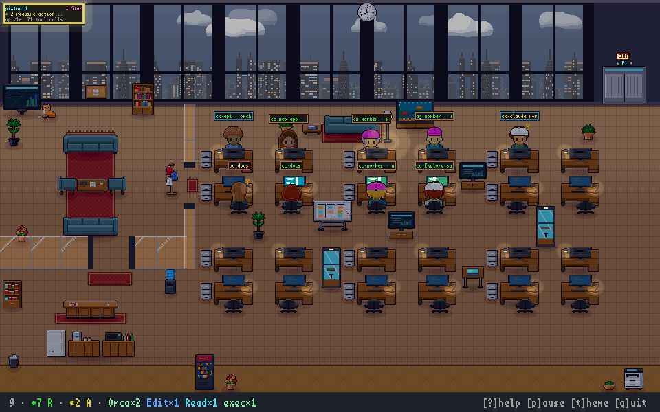

<p align="center">
  <a href="README.md"></a>&nbsp;<a href="README.md">English</a> &nbsp;·&nbsp;
  <a href="README.es.md"></a>&nbsp;<a href="README.es.md">Español</a> &nbsp;·&nbsp;
  <a href="README.de.md"></a>&nbsp;<a href="README.de.md">Deutsch</a> &nbsp;·&nbsp;
  <a href="README.ja.md"></a>&nbsp;<a href="README.ja.md">日本語</a> &nbsp;·&nbsp;
  <a href="README.zh.md"></a>&nbsp;<a href="README.zh.md">中文</a> &nbsp;·&nbsp;
  <a href="README.ru.md"></a>&nbsp;<a href="README.ru.md"><b>Русский</b></a>
</p>

# Pixtuoid para Orca

Плагин Orca для Windows. Он открывает плавающее пиксельное окно, в котором ваши локальные агенты Orca, их воркеры и субагенты показаны персонажами, каждый с подписью: провайдер, роль и проект. Вы выбираете, что показывает окно:

- **Официальный офис** (`oficina`, по умолчанию): [Pixtuoid](https://github.com/pixtuoid/pixtuoid) v0.23.0 от Ivan Wang, как он выпущен.
- **Dungeons & Agents** (`dungeon`): [Dungeons & Agents](https://github.com/icaceresc/dungeons-and-agents), фэнтези-мод Pixtuoid. Офис становится лагерем и этажами подземелья, каждый агент — искателем приключений, чей класс показывает его роль, а щелчок по искателю приключений открывает его сессию в Orca.



## Что есть в каждом режиме

| Возможность | Официальный офис | Dungeons & Agents |
|---|---|---|
| Агенты, воркеры и субагенты как персонажи с провайдером, ролью и проектом | Да | Да |
| Уведомление и счётчик в строке состояния, когда агент ждёт вас | Да | Да |
| Команды в палитре Orca; установка и обновление из Orca | Да | Да |
| Читает Orca, когда Orca сообщает об изменении агента, а не по частому таймеру | Да | Да |
| Цвет команды | По проекту | По отряду: оркестратор, его воркеры и их субагенты |
| Класс, показывающий роль (companion, orchestrator, worker, subagent) | Нет | Да |
| Инструменты как навыки; вызов CLI Orca как `Hechizo (Orca)` | Нет (показан как инструмент `Orca`) | Да |
| Щелчок по агенту или `Enter` на нём в дереве `Tab` открывает его сессию в Orca | Нет | Да |

## Требования

- Windows x64 с DirectX 12
- Python 3.11+ (64-разрядный) с запускателем `py`
- Orca 1.4.265 или новее, с хотя бы одним поддерживаемым агентом. Orca новее проверенной версии один раз показывает уведомление и, скорее всего, продолжит работать.
- `claude`, `codex` или `agy` в `PATH` для источников Claude Code, Codex или Antigravity

## Установка из Orca

1. В Orca откройте **Settings → Plugins**, выберите **From a Git URL…** и введите `https://github.com/icaceresc/pixtuoid-orca-windows` или выполните `orca plugin install icaceresc/pixtuoid-orca-windows`. Перед установкой Orca покажет, какой доступ запрашивает плагин (см. ниже).
2. В палитре команд выполните **Pixtuoid: Install or update the office app** для официального офиса или **Pixtuoid: Use Dungeons & Agents**. Команда скачивает сборку, проверяет её закреплённый SHA-256 и подключает агентов, о которых сообщает Orca.
3. Выполните **Pixtuoid: Open office window** или щёлкните **Pixtuoid** в строке состояния Orca.

| Команда | Что делает |
|---|---|
| Pixtuoid: Open office window | Открывает окно; одновременно работает только одно |
| Pixtuoid: Close office window | Закрывает его, сохраняя размер и положение |
| Pixtuoid: Install or update the office app | Устанавливает или обновляет сборку последнего выбранного режима |
| Pixtuoid: Use the official Pixtuoid office | Переключает на официальный офис |
| Pixtuoid: Use Dungeons & Agents | Переключает на Dungeons & Agents |
| Pixtuoid: Remove downloaded app and local data | Удаляет приложение, изолированный профиль агентов и журналы |

| Доступ, который запрашивает плагин | Зачем |
|---|---|
| `agent:read` | Узнавать, когда меняется состояние агента: тогда офис читает Orca, а уведомление и счётчик следуют за этим |
| `workspace:read` | Находить рабочую область агента, по которому щёлкнули, по его папке |
| `workspace:write` | Выводить сессию этого агента на передний план |
| `notifications:show` | Сообщать, когда агент ждёт вас |

**Обновление.** Плагин обновляет Orca (**Settings → Plugins** или `orca plugin update icaceresc.pixtuoid-office`). **Pixtuoid: Install or update the office app** обновляет приложение офиса до сборки, которую плагин закрепляет для его режима, и снова открывает окно, если оно было открыто. Ежедневный workflow в этом репозитории ищет новый стабильный выпуск Pixtuoid, проверяет его SHA-256, запускает тесты и предлагает новое закрепление на проверку; сам он никогда не сливает изменения.

## Что показывается

По одному персонажу на каждого агента, которого Orca распознаёт на этом компьютере. Дочерние агенты носят цвет своей команды и уходят вместе с родителем. Нажмите `Tab`, чтобы открыть дерево агентов.


| В Orca | Имя в офисе |
|---|---|
| Собственная сессия бота Orca (его Strategic Companion) | `cc·punky · companion` |
| Агент верхнего уровня | `cc·my-repo · agent` |
| Агент, запускающий воркеров, в том числе воркер | `cc·my-repo · orchestrator` |
| Воркер оркестрации, на любой глубине | `cx·worker · my-repo` |
| Воркер другого провайдера, чем у родителя | `cx·claude worker · my-repo` |
| Субагент, которого Orca видит внутри сессии | `cc·Explore subagent · my-repo` |
| Воркер агента Antigravity | `cx·worker of antigravity · my-repo` |
| Фоновая команда, монитор или вызов инструмента | Без персонажа |

Префикс — это провайдер (`cc` Claude Code, `cx` Codex, `oc` OpenCode, `ag` Antigravity), а проект — папка рабочей области Orca. На столе видны только первые символы имени; наведите указатель на персонажа или нажмите `Tab`, чтобы увидеть полное имя, родителя и текущий инструмент.

| Провайдер | Как агент | Как воркер | Собственные субагенты |
|---|---|---|---|
| Claude Code | Да | Да | Да |
| Codex | Да (1.4.263) | Да | Не проверено |
| OpenCode | Да (1.4.263) | Да (1.4.263) | Не проверено |
| Antigravity | Да (1.4.263) | Да | Orca их не сообщает |

Проверено вживую на Orca 1.4.265 и 1.4.266, или на 1.4.263, где это указано. Все четыре провайдера также проверены на настоящем Pixtuoid с записанными ответами Orca.

## Управление

| Действие | Ввод |
|---|---|
| Переместить | Перетащить пустую область |
| Изменить размер | Перетащить правый нижний угол |
| Масштаб | `Ctrl` `+` / `Ctrl` `-` / `Ctrl` `0` |
| Дерево агентов | `Tab` |
| Имя, родитель, папка и инструмент агента | Навести на него указатель |
| Открыть сессию агента в Orca (Dungeons & Agents) | Щёлкнуть по нему или нажать `Enter` на нём в дереве `Tab` |
| Справка · Пауза · Тема | `?` · `P` · `T` |
| Закрыть и сохранить размер и положение | `Q` или **Pixtuoid: Close office window** |

## Видимые состояния

| Состояние в Orca | В офисе |
|---|---|
| `working` | За столом; инструмент, о котором сообщает Orca (например, `Bash`, `Edit`, `shell`), виден на мониторе, во всплывающей подсказке и в счётчике внизу |
| `waiting` / `blocked` | Просит разрешения (`!`), учитывается как «нужен вам»; пока офис открыт, об этом сообщает уведомление на рабочем столе, а строка состояния Orca это считает |
| `done` / `idle` | Отдыхает или бродит |
| Сессия закрыта, субагент завершён или отменён | Уходит через дверь; дочерние агенты уходят первыми |

## Ограничения

- **Щелчок по агенту** открывает его сессию только в Dungeons & Agents. Панель терминального агента получает фокус. У чата Orca нет терминала, поэтому показывается его рабочая область: если в ней несколько чатов (например, дом бота), Orca показывает последний открытый там, а не обязательно тот, по которому щёлкнули. Субагент открывает сессию, в которой он работает.
- Pixtuoid связывает дочернего агента только с родителем того же провайдера. Воркер другого провайдера располагается под родителем с префиксом родителя, а в его имени указан его собственный провайдер (`cx·claude worker`). В дереве Claude Code и префикс принадлежит самому воркеру.
- Pixtuoid не может рисовать дочерних агентов под агентом Antigravity верхнего уровня: его воркеры показываются как отдельные коллеги с именем `worker of antigravity`.
- Pixtuoid сохраняет имя, с которым коллега появился впервые, поэтому агент, начавший запускать воркеров позже, уходит и возвращается как orchestrator. Роль никогда не снимается.
- Orca сообщает имя инструмента, но не модель, уровень усилий или расход токенов, поэтому офис не показывает ни модель, ни уровень усилий, ни счётчик токенов.
- С плагином офис читает Orca, как только Orca сообщает об изменении агента, а в остальное время — каждые 6 секунд, пока какой-либо агент работает, и каждые 30 секунд, пока не работает ни один, поэтому субагент может появиться с такой задержкой, а очень короткие инструменты могут быть пропущены. При запуске из клона офис читает Orca каждые 1,5–10 секунд.
- Уведомление и счётчик следуют за изменениями состояния, о которых Orca сообщает после запуска плагина.
- Показываются только субагенты, которых видит сам Orca. Агенты, уже завершённые к моменту открытия офиса, не показываются.
- Только локальный хост Orca. Удалённые окружения Orca игнорируются.

## Конфиденциальность

- Офис читает из `orca worktree ps` (и `orca agent list` как запасной вариант) только идентификаторы, связи с родителями, провайдера, тип субагента, состояние, имя инструмента, папку рабочей области и то, является ли она домом бота. Команду инструмента оболочки он просматривает только для того, чтобы понять, запускает ли она CLI Orca; промпты, ответы и входные данные инструментов никогда не пересылаются и не сохраняются.
- Пока плагин работает, он хранит в памяти состояние каждого агента и идентификаторы его панели, терминала и рабочей области. Уведомление показывает заголовок сессии из Orca, только на этом компьютере.
- Единственный сетевой доступ адаптера — скачивание закреплённой сборки с GitHub.
- Приложение, изолированный профиль агентов и журналы остаются в `%LOCALAPPDATA%\PixtuoidOrca` (в клоне, если офис запущен из него). Чтобы подписать провайдера воркера, офис записывает в изолированный профиль однострочную карточку (имя и папка) и удаляет её, когда воркер уходит или офис закрывается. Щелчок записывает туда идентификаторы выбранной сессии, которые читает плагин.
- Глобальные настройки агентов и Orca не изменяются.

## Запуск из клона

Поддерживаемый способ — плагин. Чтобы работать над адаптером или установить собственную сборку:

```powershell
git clone https://github.com/icaceresc/pixtuoid-orca-windows.git
cd pixtuoid-orca-windows
py -3 instalar.py                     # официальный офис; --modo dungeon для Dungeons & Agents
py -3 -m unittest -v test_oficina test_instalar
```

Откройте офис ярлыком **`Abrir oficina.lnk`** и закройте его клавишей `Q` или командой `py -3 oficina.py --stop`. Для щелчка по агенту нужен плагин. Чтобы ограничить источники: `py -3 instalar.py --sources claude-code codex`.

**Собственная сборка.** При закрытом офисе `py -3 instalar.py --modo dungeon --local C:\путь\к\dungeons-and-agents\target\release` устанавливает `pixtuoid.exe` и `pixtuoid-hook.exe` из локальной сборки, а также `LICENSE`, найденный рядом с ними или в корне их репозитория. `--url https://... --sha256 <64 hex>` устанавливает zip с той же структурой, что и zip Pixtuoid для Windows. `app/origen.json` записывает, что установлено и в каком режиме: последующий обычный запуск сохраняет вашу сборку и сообщает об этом, `--pinned` возвращает закреплённую сборку режима, а `--modo` переключает режим. Команды плагина делают то же самое в `%LOCALAPPDATA%\PixtuoidOrca`.

## Удаление

Выполните **Pixtuoid: Remove downloaded app and local data**, затем удалите плагин в **Settings → Plugins**. Для клона достаточно удалить его папку.

## Благодарности и лицензия

- Этот плагин: [лицензия MIT](LICENSE).
- [Pixtuoid](https://github.com/pixtuoid/pixtuoid) от Ivan Wang, лицензия MIT. Скачивается при установке, не распространяется повторно.
- [Dungeons & Agents](https://github.com/icaceresc/dungeons-and-agents), мод Pixtuoid, лицензия MIT. Скачивается при установке, не распространяется повторно.
- Значки флагов: [lipis/flag-icons](https://github.com/lipis/flag-icons) v7.2.3, [лицензия MIT](docs/flags/LICENSE).
- Orca — отдельный продукт и не входит в комплект. Это независимый плагин, а не официальный проект Pixtuoid или Orca.
