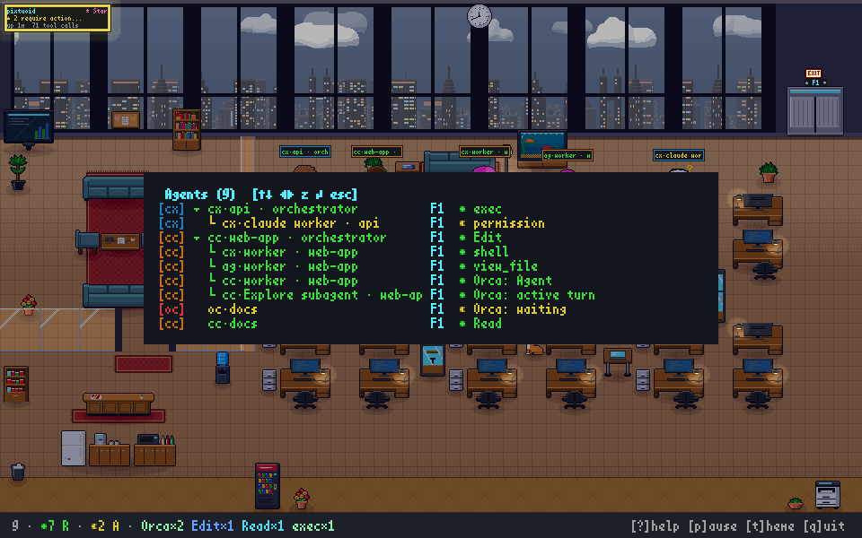

<p align="center">
  <a href="README.md"></a>&nbsp;<a href="README.md">English</a> &nbsp;·&nbsp;
  <a href="README.es.md"></a>&nbsp;<a href="README.es.md">Español</a> &nbsp;·&nbsp;
  <a href="README.de.md"></a>&nbsp;<a href="README.de.md">Deutsch</a> &nbsp;·&nbsp;
  <a href="README.ja.md"></a>&nbsp;<a href="README.ja.md">日本語</a> &nbsp;·&nbsp;
  <a href="README.zh.md"></a>&nbsp;<a href="README.zh.md"><b>中文</b></a> &nbsp;·&nbsp;
  <a href="README.ru.md"></a>&nbsp;<a href="README.ru.md">Русский</a>
</p>

# Windows 版 Orca 的 Pixtuoid

一个悬浮的像素风办公室，把你本机的 Orca 智能体、它们的 worker 和子智能体显示为同事，每个人都标有提供方、角色和项目。它从本仓库的克隆中运行。


## 显示内容

Orca 在这台机器上识别出的每个智能体对应一个角色。子级戴着团队颜色的帽子，并随父级一起离开。按 `Tab` 查看智能体树。



| 在 Orca 中 | 在办公室中的名称 |
|---|---|
| Orca 机器人自己的会话（其 Strategic Companion） | `cc·punky · companion` |
| 顶层智能体 | `cc·my-repo · agent` |
| 派发 worker 的智能体（包括 worker 本身） | `cc·my-repo · orchestrator` |
| 编排 worker（任意层级） | `cx·worker · my-repo` |
| 与父级提供方不同的 worker | `cx·claude worker · my-repo` |
| Orca 在会话中观察到的子智能体 | `cc·Explore subagent · my-repo` |
| Antigravity 智能体的 worker | `cx·worker of antigravity · my-repo` |
| 后台命令、监视器或工具调用 | 无角色 |

前缀是提供方（`cc` Claude Code、`cx` Codex、`oc` OpenCode、`ag` Antigravity），项目是 Orca 工作区的文件夹。桌牌只显示名称的前几个字符；将指针悬停在角色上或按 `Tab`，可查看完整名称、父级和当前工具。

已在 Orca 1.4.266（注明处为 1.4.263）上用 Pixtuoid v0.23.0 实际验证。全部四个提供方还使用录制的 Orca 响应，针对真实的 Pixtuoid 做了检查。

| 提供方 | 作为智能体 | 作为 worker | 原生子智能体 |
|---|---|---|---|
| Claude Code | 是 | 是 | 是 |
| Codex | 是 (1.4.263) | 是 | 未验证 |
| OpenCode | 是 (1.4.263) | 是 (1.4.263) | 未验证 |
| Antigravity | 是 (1.4.263) | 是 | Orca 未报告 |

## 系统要求

- 支持 DirectX 12 的 Windows x64
- Python 3.11+（64 位），带 `py` 启动器
- Orca 1.4.263 或更高版本，正在运行，并至少安装一个受支持的智能体。已验证到 1.4.266；更新的 Orca 会显示一次提示，应可继续工作。
- Claude Code、Codex 或 Antigravity 来源需要 `PATH` 中有 `claude`、`codex` 或 `agy`

## 快速安装

```powershell
git clone https://github.com/icaceresc/pixtuoid-orca-windows.git
cd pixtuoid-orca-windows
py -3 instalar.py
py -3 -m unittest -v test_oficina test_instalar
```

`instalar.py` 将 Pixtuoid v0.23.0 下载到克隆目录中，校验其 SHA-256，并连接 Orca 报告的智能体。限制来源：`py -3 instalar.py --sources claude-code codex`。

**自己的构建。** 关闭办公室后，`py -3 instalar.py --local C:\path\to\pixtuoid\target\release` 会安装本地构建中的 `pixtuoid.exe` 和 `pixtuoid-hook.exe`，以及其旁边或其仓库根目录中的 `LICENSE`。`py -3 instalar.py --url https://... --sha256 <64 位十六进制>` 会安装你发布的、与 Pixtuoid Windows zip 结构相同的 zip；SHA-256 为必填。`app/origen.json` 记录已安装的内容：之后不带选项运行 `py -3 instalar.py` 会保留你的构建并给出提示，`py -3 instalar.py --pinned` 则回到 v0.23.0。

**更新。** 本仓库中的每日工作流会查找新的 Pixtuoid 稳定版本，校验其 SHA-256，运行测试，并提出新的版本固定供审阅；它从不自行合并。拉取更新后，关闭办公室并再次运行 `py -3 instalar.py`。

Orca 插件（v2.0.0）已暂停：它仍可安装并打开办公室，但没有上述功能。请使用克隆。

## 打开办公室

双击 **`Abrir oficina.lnk`**。按 `Q` 关闭，或运行 `py -3 oficina.py --stop`。

窗口悬浮在 Orca 之外，可以放在第二个显示器上。每个文件夹只运行一个办公室。它启动的所有进程都以低于正常的优先级运行，每个周期只用一次 CLI 调用读取 Orca，让你的电脑优先。`py -3 oficina.py --evidence` 会把状态记录到 `actividad/`。

## 操作

| 操作 | 输入 |
|---|---|
| 移动 | 拖动空白区域 |
| 调整大小 | 拖动右下角 |
| 缩放 | `Ctrl` `+` / `Ctrl` `-` / `Ctrl` `0` |
| 智能体树 | `Tab` |
| 智能体的名称、父级、文件夹和工具 | 将指针悬停在其上 |
| 帮助 · 暂停 · 主题 | `?` · `P` · `T` |
| 关闭并保存大小和位置 | `Q`，或 `py -3 oficina.py --stop` |

## 可见状态

| Orca 状态 | 在办公室中 |
|---|---|
| `working` | 在办公桌前；Orca 报告的工具（如 `Bash`、`Edit`、`shell`）显示在显示器、提示框和底部统计中 |
| `waiting` / `blocked` | 请求权限（`!`），计为“需要你” |
| `done` / `idle` | 休息或闲逛 |
| 会话关闭、子智能体完成或取消 | 从门口离开；其子级先离开 |

## 限制

- Pixtuoid 只会把子级关联到同一提供方的父级。其他提供方的 worker 位于父级之下，使用父级的前缀和颜色，其名称写明它自己的提供方（`cx·claude worker`）。在 Claude Code 树中，前缀也是 worker 自己的。
- Pixtuoid 无法在顶层 Antigravity 智能体下绘制子级：它的 worker 显示为名为 `worker of antigravity` 的独立同事。
- Pixtuoid 保留同事首次出现时的名称，因此之后才开始派发的智能体会先离开，再以 orchestrator 身份回来。角色不会被收回。
- Orca 只报告工具名称，不报告模型、推理强度或 token 用量，因此办公室不显示模型、推理强度或 token 计量。从不读取工具的输入，因此旁边不会出现文件或命令。
- 点击角色不会聚焦其终端：Orca 不公开智能体进程，而 Pixtuoid 在 Windows 上的聚焦只支持它自己的 Antigravity 集成。
- 办公室在两次读取 Orca 之间等待 1.5 到 10 秒，电脑或 Orca 繁忙时更久，因此可能漏掉非常短的轮次和工具。Orca 繁忙时，新的子级可能会先短暂出现，再移到其父级之下。
- 只显示 Orca 自己观察到的子智能体。打开办公室时已经结束的智能体不会显示。
- 仅限本地 Orca 主机。远程 Orca 环境会被忽略。

## 隐私

- 办公室只从 `orca worktree ps`（以及作为后备的 `orca agent list`）读取 ID、父级链接、提供方、子智能体类型、状态、工具名称、工作区文件夹以及该工作区是否为机器人的主目录。提示词、回复和工具输入从不转发或存储。
- 适配器唯一的网络访问是从 GitHub 下载固定版本的 Pixtuoid。
- 应用、隔离的智能体配置和日志都留在克隆目录中（`app/`、`perfil/`、`actividad/`）。为了标明 worker 的提供方，办公室会在隔离配置中写入一行卡片（名称和文件夹），并在 worker 离开或办公室关闭时删除它。
- 不修改智能体和 Orca 的全局设置。

## 卸载

关闭办公室并删除克隆文件夹。不会安装其他任何东西。如果你安装了已暂停的插件，请运行 **Pixtuoid: Remove downloaded app and local data**，然后在 Orca 的 Settings → Plugins 中卸载它。

## 致谢与许可证

- 本适配器：[MIT 许可证](LICENSE)。
- [Pixtuoid](https://github.com/pixtuoid/pixtuoid)，作者 Ivan Wang，MIT 许可证。在安装时下载，不再分发。
- 旗帜图标：[lipis/flag-icons](https://github.com/lipis/flag-icons) v7.2.3，[MIT 许可证](docs/flags/LICENSE)。
- Orca 是独立产品，不包含在内。这是一个独立的适配器，不是 Pixtuoid 或 Orca 的官方项目。
